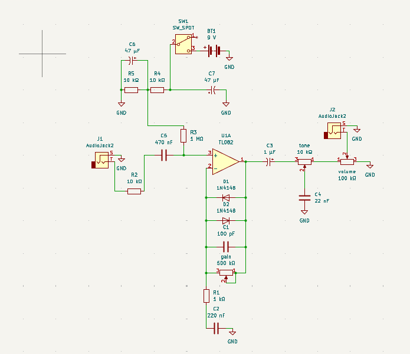
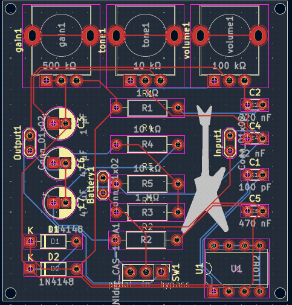

# A compact and easy-to-use analog overdrive guitar pedal.

## Images

Circuit schematic | PCB layout
--- | ---
 | 

 
## What is this?
 
this is a simple fully analog overdrive pedal that i designed personally, some of the graphics on the pcb are inspire by a Dean From Hell guitar

The goal was to create an affordable and straightforward guitar effect while learning more about analog electronics, audio circuits and PCB design.
it features one tl082 amplifier, two 1N§14B clipping diodes and three gain, tone, volume pots

## Features:

Fully analog signal processing.
TL082 dual operational amplifier.
Two 1N4148 clipping diodes.
Three adjustable controls: Gain, Tone and Volume.
Custom-designed PCB and circuit schematic.
Compact design suitable for a DIY guitar pedal enclosure.
Affordable and beginner-friendly construction.
 
 
## Building it

1. Order the PCB from JLCPCB using the KiCad project files.
2. you can build a case with simple household materials or buy a box from an hardware store
3. Assemble the PCB
4. put the pcb in the case

## Cost Estimate

The estimated cost of building one pedal is approximately $50 or less. Actual costs may vary depending on the PCB manufacturer, component availability, enclosure and shipping.
