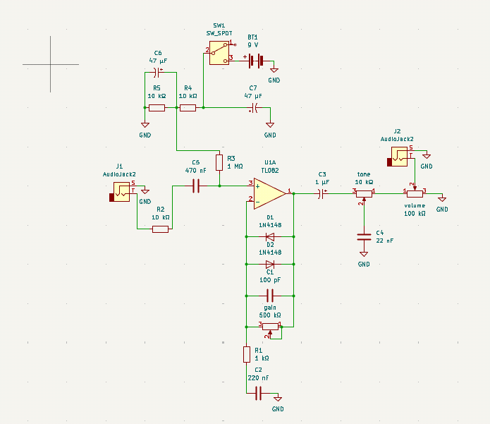

A compact and easy-to-use analog overdrive guitar pedal.

## Images

Circuit schematic | PCB layout
--- | ---
 | [PCB design files](Pedal_pcb/)
 
## What is this?
 
this is the a simple overdrive pedal that i designed personally 
 
## Bill of materials

Qty | Part | Notes
--- | --- | ---
1 | TL082 operational amplifier (`U1A`) | Main amplifier stage
2 | 1N4148 diodes (`D1`, `D2`) | Signal clipping
1 | Gain potentiometer | 500 kΩ
1 | Tone potentiometer | 10 kΩ
1 | Volume potentiometer | 100 kΩ
1 | SPDT switch (`SW1`) | Power switch
1 | 9V battery or suitable 9V supply (`BT1`) | Power source
2 | 1/4-inch audio jacks (`J1`, `J2`) | Input and output
1 | Custom PCB | Design files in `Pedal_pcb/`
1 | Set of resistors | Values as specified in the schematic
1 | Set of capacitors | Values as specified in the schematic
 
## Building it

1. Order the PCB from JLCPCB using the KiCad project files.
2. you can build a case with simple household materials
3. Assemble the PCB
4. put the pcb in the case
